<div align="center">

<picture>
  <source media="(prefers-color-scheme: dark)" srcset=".github/assets/banner-dark.svg">
  
</picture>

**Inspect and prepare media without loading whole files into PHP.**<br>
Metadata, an EXIF-aware image pipeline, upload-ready video transcoding, batched thumbnails and an embedded camera, through native codecs with sandboxed paths and bounded results.

[](https://packagist.org/packages/pushinbr/pam-native-media)
[](https://github.com/push-in/pam-native-media/releases/latest)

[](https://github.com/push-in/pam-native-media/actions/workflows/ci.yml)
[](LICENSE)

[Install](#install) · [Quick example](#quick-example) · [Platforms](#platform-support) · [Permissions](#requirements) · [Docs](#docs) · [Issues](https://github.com/push-in/pam-native-media/issues)

</div>

<a id="install"></a>
## <picture></picture> Install

Inside a PAM Native project, add only this capability:

```sh
pam composer require pushinbr/pam-native-media
pam doctor --fix
```

Composer resolves the package and updates the normal `composer.json` and `composer.lock`; `pam doctor --fix` refreshes the generated native integration. The package is a PAM Native plugin (module `media`, view `media.camera`); nothing is added to `pam-native.json`. Use `pam packages` to inspect availability. New to PAM? Follow the [five-minute PAM Native setup](https://push-in.github.io/pam-docs/native/overview/) once (`pam init my-app --template native`).

<a id="quick-example"></a>
## <picture></picture> Quick example

```php
use Pam\Native\Media\{ImageFormat, ImageResult, Media, ResizeMode, TranscodeResult, VideoPreset};

// Upload-ready MP4 (H.264 Main / AAC-LC, bounded size, 2 s keyframes, fast start)
$task = Media::transcode('captures/clip.mov')
    ->to('outbox/clip.mp4')
    ->preset(VideoPreset::Chat720p)
    ->fastStart()
    ->progress(fn (float $p) => $this->encoding = $p)
    ->run(
        fn (TranscodeResult $video) => $this->send($video->path),
        fn (string $error) => $this->fail($error),
    );
// $task->cancel();

// Image pipeline: EXIF orientation first, then operations in call order
Media::image('captures/photo.jpg')
    ->resize(1920, 1920, ResizeMode::Contain)
    ->onlyScaleDown()
    ->format(ImageFormat::Webp, 82)
    ->save('outbox/photo.webp', fn (ImageResult $image) => $this->send($image->path));
```

Paths are relative to the PAM file sandbox; PHP never holds pixel data and outputs are written atomically. Full walk-through (presets, thumbnails, the 0.3 API, platform notes): [docs/usage.md](docs/usage.md). Embedded camera: [docs/camera.md](docs/camera.md). A production example: [docs/zechat-example.md](docs/zechat-example.md). A runnable one-screen app: [`example/`](example).

<a id="platform-support"></a>
## <picture></picture> Platform support

| Platform | Support | Notes |
| --- | --- | --- |
| Android | API 26+ | Media3 Transformer 1.10.1, CameraX 1.6.1, ExifInterface 1.4.2 |
| iOS | 15.0+ | AVFoundation, ImageIO, Photos; transcode and image pipeline since 0.5, not yet validated on a device |
| PAM Native | 1.46.0 to < 2.0.0 | From `pam-native.plugin.json`; PHP 8.5+ |

<a id="requirements"></a>
## <picture></picture> Permissions and requirements

| Platform | Declared by the plugin |
| --- | --- |
| Android | `CAMERA`, `RECORD_AUDIO`, `READ_MEDIA_IMAGES`, `READ_MEDIA_VIDEO`, `READ_MEDIA_VISUAL_USER_SELECTED`, `READ_EXTERNAL_STORAGE`, `WRITE_EXTERNAL_STORAGE` (all `android.permission.*`) |
| iOS | `NSCameraUsageDescription` ("Capture photos and videos."), `NSMicrophoneUsageDescription` ("Record audio with videos.") |

Only `CameraView` uses the camera and microphone: request `PermissionKind::Camera`/`Microphone` before enabling the view. Other plugins that declare the same iOS keys (`pam-native-webrtc`, `pam-native-camera`) use the same strings, because the CLI rejects conflicting values.

Android dependencies: CameraX `1.6.1` (`camera-camera2`, `camera-lifecycle`, `camera-view`, `camera-video`), Media3 `1.10.1` (`media3-common`, `media3-effect`, `media3-transformer`) and ExifInterface `1.4.2`. iOS frameworks: `AVFoundation`, `CoreGraphics`, `CoreMedia`, `CoreVideo`, `ImageIO`, `UniformTypeIdentifiers`, `Photos`, `UIKit`.

<a id="what-you-can-build"></a>
## <picture></picture> What you can build

- Gallery and attachment pickers
- Upload preparation and validation
- Fast thumbnail pipelines for local media libraries

| | |
| --- | --- |
| **Best for** | A focused capability you can add to any PAM Native application |
| **Native path** | MediaMetadataRetriever · Media3 · CameraX · AVFoundation |
| **Application model** | Composer package + generated native integration |
| **Design rule** | Independent module; no feed, vertical or application template bundled |

<a id="capabilities"></a>
## <picture></picture> Capabilities

- `Media::transcode()`: H.264/AAC MP4 with presets `Compact480p`, `Chat720p`, `Chat1080p`, `Adaptive`, bitrate cap, fast start, progress and cancellation
- `Media::image()`: EXIF-oriented resize, crop, rotate, flip and JPEG/PNG/WebP encoding, plus `probe()`
- `Media::thumbnails()`: 1 to 100 thumbnails in one native call (sandbox paths or HTTPS video URLs)
- `(new Media())->probe()` / `thumbnail()`: the unchanged 0.3 API
- `CameraView`: lifecycle-aware embedded camera with revision-based photo/video capture, flash and torch, recording zoom ramps, pinch zoom, double-tap lens flip and Android tap to focus
- `MediaLibrary` (gallery assets, albums, thumbnails, save) and `ViewCapture` (capture a mounted view to an image)
- Stable cross-plugin entry points (`dev.pam.media.MediaTranscoding` on the JVM, `PamMediaTranscoding` on iOS) used by `pushinbr/pam-native-background-transfer`

Full API: [docs/api-reference.md](docs/api-reference.md).

<a id="production-rules"></a>
## <picture></picture> Production checklist

- Request camera and microphone permissions before enabling capture.
- Move or upload captures using their sandbox-relative `FileReference`.
- Bound recording duration, thumbnail dimensions and retained media.
- Run `pam doctor`, `pam test` and a signed release build on every supported platform.
- Exercise denial, cancellation, backgrounding, process restart and offline behavior before release.

<a id="troubleshooting"></a>
## <picture></picture> Troubleshooting

- **A path is rejected:** use app-relative paths and never absolute/traversal paths.
- **Preview works but capture fails:** verify permissions and available device storage.
- **Combined streams fail on a device:** enable only the outputs required by the selected mode.
- **Native integration is stale:** run `pam doctor --fix`, rebuild the native host and inspect the first reported diagnostic.

<a id="compatibility"></a>
## <picture></picture> Compatibility

| `pushinbr/pam-native-media` | `pushinbr/pam-native` | Android | iOS |
| --- | --- | --- | --- |
| 0.7.x (current manifest) | `>=1.46.0 <2.0.0` | API 26+ | 15+ |
| 0.5.x | `>=1.0.35 <2.0.0` (tested with 1.14.x) | API 26+ | 15+ (transcode, image pipeline, batches) |
| 0.4.x | `>=1.0.35 <2.0.0` | API 26+ | Probe, thumbnails and camera only |

**Core extraction (1.46):** requires `pushinbr/pam-native` ^1.46. The core keeps deprecated PHP aliases through 1.46; they are removed in 1.47. Native wire contracts are retained. Swift compilation and device QA remain pending.

Platform SDKs, credentials, entitlements, physical hardware and store configuration remain application responsibilities.

<a id="tests"></a>
## <picture></picture> Tests

`pam composer test` runs the PHP contract suite. Android JVM tests (`android/src/test`: resize geometry, fast-start rewriting, options, recording and gesture zoom math) and instrumented tests (`android/src/androidTest`: EXIF pipeline, thumbnails, Media3 transcode, cross-plugin entry point) run from a PAM Android host that includes this plugin with `testDebugUnitTest` / `connectedDebugAndroidTest`. JVM tests require JUnit 4 and the JVM `org.json` implementation on the test classpath (the Android SDK JSON stub cannot execute parser tests).

On macOS, run the focused sizing and sandbox checks with `swiftc ios/Sources/MediaThumbnailSizing.swift ios/Sources/MediaSandboxPath.swift tests/ios-thumbnail/main.swift -o /tmp/pam-media-ios-check && /tmp/pam-media-ios-check`.

<a id="docs"></a>
## <picture></picture> Docs

- [Usage: transcoding, images and thumbnails](docs/usage.md)
- [Embedded camera](docs/camera.md)
- [API reference](docs/api-reference.md)
- [A real example: Zé Chat](docs/zechat-example.md)
- [Runnable demo app](example/README.md)
- [PAM Native overview](https://push-in.github.io/pam-docs/native/overview/)
- [Plugin and native capability model](https://push-in.github.io/pam-docs/native/plugins/)
- [Changelog](CHANGELOG.md)
- [Report an issue](https://github.com/push-in/pam-native-media/issues): security vulnerabilities go through the repository security policy or GitHub private vulnerability reporting, not a public issue

<a id="pam-ecosystem"></a>
## <picture></picture> Part of the PAM ecosystem

PAM runs PHP natively on servers, desktops and phones. This repository is one piece of it.

| [**PAM**](https://github.com/push-in/pam) | [**PAM Desktop**](https://github.com/push-in/pam-desktop) | [**PAM Native**](https://github.com/push-in/pam-native) | [**Ecosystem**](https://github.com/push-in/pam#ecosystem) |
| --- | --- | --- | --- |
| the runtime and CLI | native desktop apps in PHP | native Android and iOS apps in PHP | every official package and plugin |

<sub>Docs: [push-in.github.io/pam-docs](https://push-in.github.io/pam-docs/introduction/) · [Issues](https://github.com/push-in/pam-native-media/issues)</sub>

<p align="center"><sub><a href="LICENSE">Apache License 2.0</a> · Made in Brazil by Pushin</sub></p>
